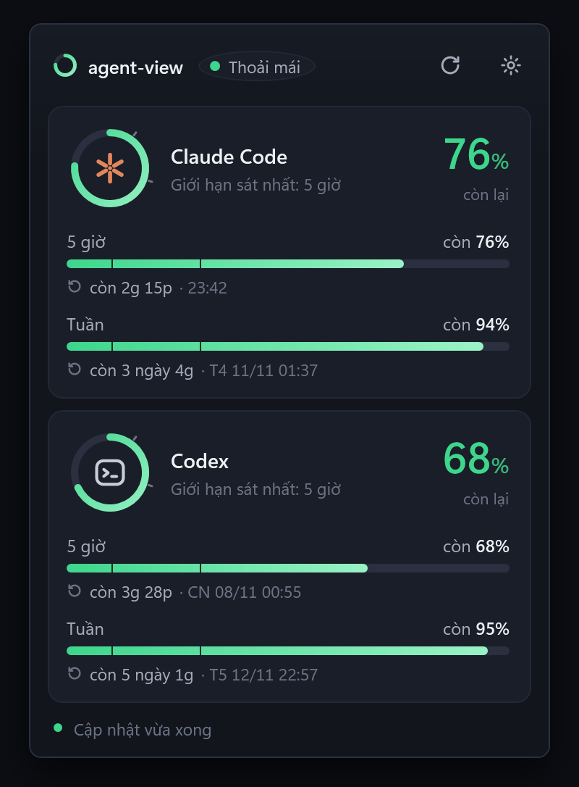
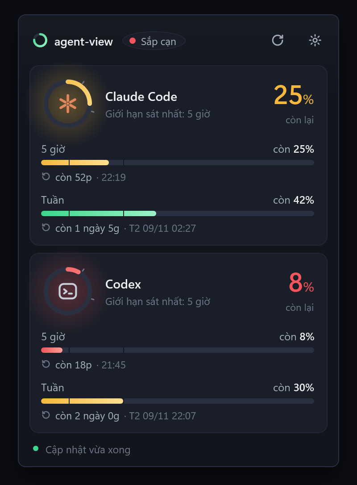
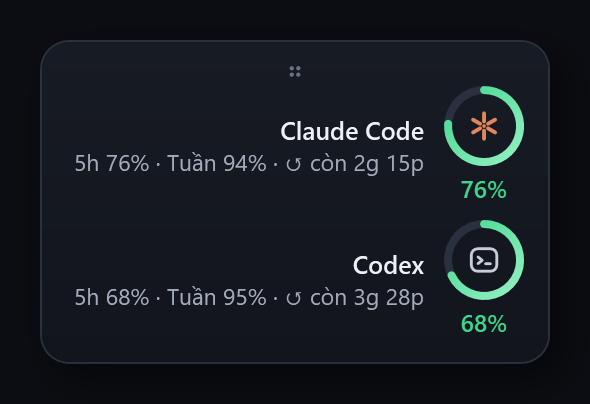
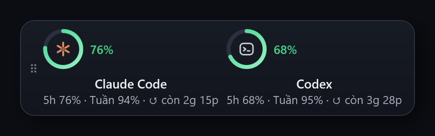

# agent-view

**See how much Claude Code and Codex quota you have left, right in the Windows tray.**


<p align="center">
  
</p>

<p align="center">
  
</p>

The tray icon shows the lowest remaining percentage across your 5-hour and weekly limits. Click it for details, or keep a small widget docked to a screen edge.

## Quick start

Run in Windows PowerShell:

```powershell
irm https://raw.githubusercontent.com/blake-ai-slop/agent-view/main/install.ps1 | iex
```

1. The installer asks whether to start at sign-in, enable the floating widget, and start now.
2. Files go into `%LOCALAPPDATA%\agent-view`, and the `agentview` command is added to your user PATH.
3. The app appears in the tray, and the installer prints your current remaining quota.

Open a new terminal, then check it:

```powershell
agentview status
```

You need Windows 10 or 11 with the built-in Windows PowerShell 5.1, and Claude Code and/or Codex CLI installed and signed in.

## Features

- **5-hour and weekly limits** as a percentage remaining, for Claude Code and Codex.
- **Color by level:** green above 30%, amber at 11–30%, red at 10% or less.
- **Detail popup** with both windows per provider and a countdown to each reset.
- **Floating widget** that docks to the left, right, or top screen edge and remembers its place.
- **Only what exists:** if a provider reports just one window, the other is hidden.
- **`agentview` command** to start, stop, check status, update, and uninstall.
- **No exe, no dependencies:** plain PowerShell scripts on what ships with Windows.
- **No credentials read:** quota comes from the provider CLIs you already use.

<p align="center">
  
  &nbsp;
  
</p>
<p align="center">
  
</p>

> The app, installer, and terminal messages are currently in Vietnamese.

## Installation options

In an interactive terminal with no options set, the installer asks its questions. Setting any option below skips the prompts and uses these defaults: start at sign-in on (unchanged for an existing install), widget unchanged (off for a new install), and start now.

| Option | Environment variable | Effect |
| --- | --- | --- |
| `-Yes` | `AGENT_VIEW_YES=1` | Accept defaults without prompts. |
| `-NoAutostart` | `AGENT_VIEW_NO_AUTOSTART=1` | Do not start at sign-in. |
| `-Widget` | `AGENT_VIEW_WIDGET=1` | Enable the floating widget. |
| `-NoStart` | `AGENT_VIEW_NO_START=1` | Install without starting the app now. |
| `-Quiet` | `AGENT_VIEW_QUIET=1` | Print errors only, with no notification. |
| `-Source <url-or-folder>` | `AGENT_VIEW_SOURCE` | Install from another base URL or a local checkout. |

Environment variables accept `1`, `true`, `yes`, `y`, or `on`. To pass options to the one-line install, set the variables first:

```powershell
$env:AGENT_VIEW_YES = '1'; $env:AGENT_VIEW_WIDGET = '1'
irm https://raw.githubusercontent.com/blake-ai-slop/agent-view/main/install.ps1 | iex
```

Or run the downloaded script as a script block with switches:

```powershell
& ([scriptblock]::Create((irm https://raw.githubusercontent.com/blake-ai-slop/agent-view/main/install.ps1))) -Yes -Widget
```

From a downloaded copy or a checkout:

```powershell
powershell.exe -NoProfile -ExecutionPolicy Bypass -File .\install.ps1 -Yes -NoAutostart
```

### Update or reinstall

Run `agentview update`, or run the install command again. Reinstalling keeps your choices: start at sign-in stays as it was and the widget setting is preserved. The installer downloads every file before touching an existing install; if copying fails, it restores the previous files and reports the failed step.

### Uninstall

Run `agentview uninstall` (`agentview uninstall -y` in a non-interactive shell), or run the installed script directly:

```powershell
& "$env:LOCALAPPDATA\agent-view\uninstall.ps1"
```

Uninstall stops the app, removes the command directory from the user PATH, deletes the Startup shortcut, and removes `%LOCALAPPDATA%\agent-view`, including saved settings. Add `-Quiet` (or set `AGENT_VIEW_QUIET=1`) to print errors only.

## Usage

- **Tray icon:** shows the lowest remaining percentage. Hover for a summary.
- **Click** the icon to open the detail popup. Press Esc or click elsewhere to close it.
- **Right-click** to refresh, toggle the floating widget, toggle start at sign-in, or quit.
- **Widget:** hover to expand, click to open the popup, drag the grip to dock it to another edge. Its edge, position, and visibility are saved in `%LOCALAPPDATA%\agent-view\settings.json`.

### Terminal commands

| Command | Effect |
| --- | --- |
| `agentview up` | Start the app if it is not running (alias: `start`). |
| `agentview down` | Stop the app (alias: `stop`). |
| `agentview restart` | Restart the app. |
| `agentview status [--json]` | Show remaining quota and app state; `--json` prints machine-readable output. |
| `agentview widget [on\|off]` | Show or change the floating widget setting. |
| `agentview autostart [on\|off]` | Show or change start at sign-in. |
| `agentview update` | Install the latest version, keeping current choices. |
| `agentview uninstall [-y]` | Remove agent-view; `-y` skips the confirmation. |
| `agentview version` | Print the version (also `-v`, `--version`). |
| `agentview help` | List commands (also `-h`, `--help`). |

Changing the widget or start-at-sign-in setting restarts the app if it is running. `agentview update` uses `AGENT_VIEW_SOURCE` when it is set.

## How it works and privacy

**Claude Code.** The app reads the usage that Claude Code already caches locally in `.claude.json` (or under `CLAUDE_CONFIG_DIR`). When that cache is older than 5 minutes, it runs the Claude CLI's `/usage` command in print mode, which makes no model turn, at most once every 5 minutes, so Claude Code refreshes its own cache; then it reads the cache again. Once a reset time has passed, that window is shown as full again. Cached data is used for up to 7 days.

**Codex.** The app asks the local Codex CLI through its `app-server` rate-limit API.

**What stays private.** The app does not read credential files, does not store account details, and does not send data anywhere. Only quota percentages and reset times are kept, for display. The only network traffic is the provider CLIs talking to their own services.

## FAQ

**The Claude number doesn't change.**
Claude Code updates its cached usage as you use it, and agent-view refreshes it at most every 5 minutes. Right-click the tray icon and choose refresh, or run `agentview status`. If the Claude CLI is not on your PATH, the app can only show the cached data.

**The widget doesn't show.**
Turn it on with `agentview widget on` or from the tray menu. It docks to the left, right, or top edge of the screen where you last left it; if that screen is gone, it moves to the primary screen.

**How do I uninstall?**
Run `agentview uninstall`. See [Uninstall](#uninstall).

**Does it use up my quota?**
No. The Claude `/usage` check and the Codex rate-limit query make no model turns.

## Development

No build step is required. Run from a checkout:

```powershell
powershell.exe -NoProfile -STA -File src/agent-view.ps1
powershell.exe -NoProfile -File tools/parse-check.ps1
powershell.exe -NoProfile -STA -Command "Invoke-Pester tests -EnableExit"
```

Tests use Pester 3.4, included with Windows PowerShell 5.1, and must run in an STA session. UI tests require an interactive Windows desktop.

## License

[MIT](LICENSE)
