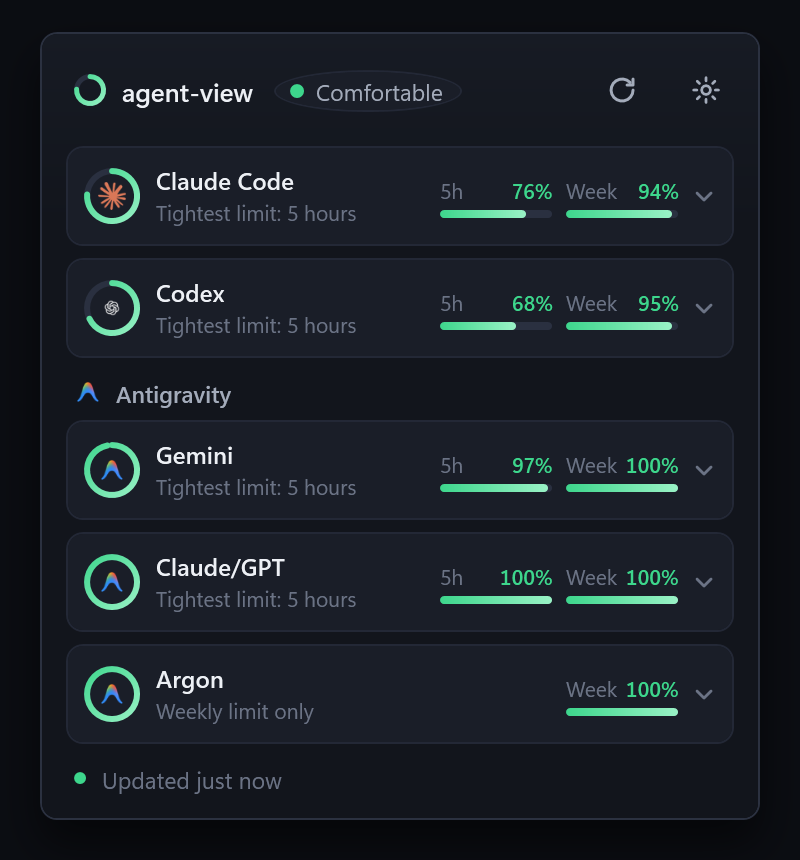
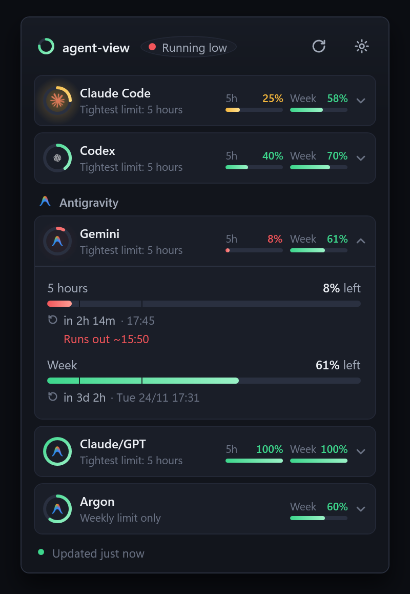
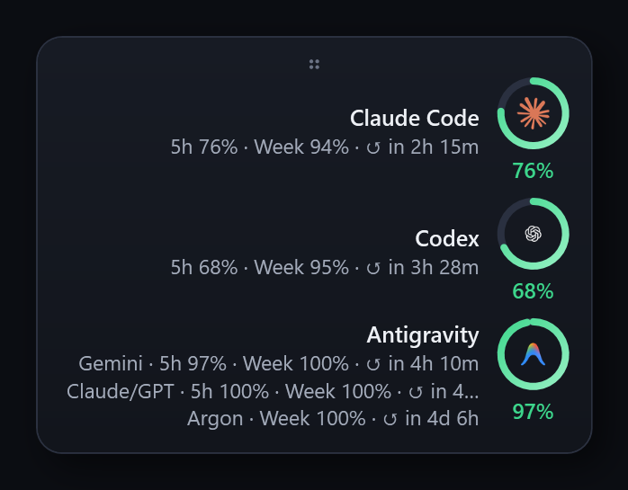
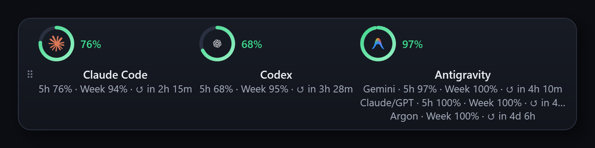

# agent-view

**See how much Claude Code, Codex, and Antigravity quota you have left, right in the Windows tray.**


<p align="center">
  
</p>

<p align="center">
  
</p>

The tray icon shows the lowest remaining percentage across your 5-hour and weekly limits. Click it for details, or keep a small widget docked to a screen edge.

## Quick start

Run in Windows PowerShell or PowerShell 7:

```powershell
irm https://raw.githubusercontent.com/blake-ai-slop/agent-view/main/install.ps1 | iex
```

1. A small bootstrap (`install.ps1`) downloads the installer (`installer.ps1`) and runs it in Windows PowerShell. The installer lists the agents it found and asks which ones to show, then whether to start at sign-in, enable the floating widget, and start now.
2. Files go into `%LOCALAPPDATA%\agent-view`, and the `agentview` command is added to your user PATH.
3. The app appears in the tray, and the installer prints your current remaining quota.

Open a new terminal, then check it:

```powershell
agentview status
```

You need Windows 10 or 11 with the built-in Windows PowerShell 5.1, and at least one of Claude Code, Codex CLI, or Antigravity CLI (`agy`) installed and signed in.

## Features

- **5-hour and weekly limits** as a percentage remaining, for Claude Code, Codex, and each Antigravity model group (Gemini, Claude/GPT, Argon).
- **Finds your agents:** only installed agents are shown and queried; install one later and it appears on its own.
- **Color by level:** green above 30%, amber at 11–30%, red at 10% or less.
- **Compact popup:** one row per agent or group with both windows; click a row for reset countdowns and a run-out forecast.
- **Notifications** when a window runs low and when it is full again.
- **Settings window** for language, refresh interval, notifications, widget, start at sign-in, and which agents or groups to show.
- **Floating widget** that docks to the left, right, or top screen edge and remembers its place.
- **Only what exists:** if a provider reports just one window, the other is hidden.
- **`agentview` command** to start, stop, check status, update, and uninstall.
- **No exe, no dependencies:** plain PowerShell scripts on what ships with Windows.
- **No credentials read:** quota comes from the provider CLIs you already use.

<p align="center">
  
  &nbsp;
  
</p>
<p align="center">
  
</p>

> The app, installer, and terminal support English and Vietnamese. The default language follows Windows; use `agentview lang auto|vi|en` to change it.

## Installation options

In an interactive terminal with no options set, the installer asks its questions. Setting any option below skips the prompts and uses these defaults: start at sign-in on (unchanged for an existing install), widget unchanged (off for a new install), and start now.

| Option | Environment variable | Effect |
| --- | --- | --- |
| `-Yes` | `AGENT_VIEW_YES=1` | Accept defaults without prompts. |
| `-NoAutostart` | `AGENT_VIEW_NO_AUTOSTART=1` | Do not start at sign-in. |
| `-Widget` | `AGENT_VIEW_WIDGET=1` | Enable the floating widget. |
| `-NoStart` | `AGENT_VIEW_NO_START=1` | Install without starting the app now. |
| `-Quiet` | `AGENT_VIEW_QUIET=1` | Print errors only, with no notification. |
| `-Providers <ids>` | `AGENT_VIEW_PROVIDERS` | Agents to show, comma-separated: `claude`, `codex`, `antigravity`. Default: the detected ones. |
| `-Source <url-or-folder>` | `AGENT_VIEW_SOURCE` | Install from another base URL or a local checkout. |

Environment variables accept `1`, `true`, `yes`, `y`, or `on`. To pass options to the one-line install, set the variables first:

```powershell
$env:AGENT_VIEW_YES = '1'; $env:AGENT_VIEW_WIDGET = '1'
irm https://raw.githubusercontent.com/blake-ai-slop/agent-view/main/install.ps1 | iex
```

Or run the downloaded script as a script block with switches:

```powershell
& ([scriptblock]::Create((irm https://raw.githubusercontent.com/blake-ai-slop/agent-view/main/install.ps1))) -Yes -Widget
```

From a checkout (it uses the `installer.ps1` next to it; a lone `install.ps1` downloads it):

```powershell
powershell.exe -NoProfile -ExecutionPolicy Bypass -File .\install.ps1 -Yes -NoAutostart
```

### Update or reinstall

Run `agentview update`, or run the install command again. Reinstalling keeps your choices: start at sign-in stays as it was, and the widget setting and the agents you chose are preserved. The installer downloads every file before touching an existing install; if copying fails, it restores the previous files and reports the failed step.

### Uninstall

Run `agentview uninstall` (`agentview uninstall -y` in a non-interactive shell), or run the installed script directly:

```powershell
& "$env:LOCALAPPDATA\agent-view\uninstall.ps1"
```

Uninstall stops the app, removes the command directory from the user PATH, deletes the Startup shortcut, and removes `%LOCALAPPDATA%\agent-view`, including saved settings. Add `-Quiet` (or set `AGENT_VIEW_QUIET=1`) to print errors only.

## Usage

- **Tray icon:** shows the lowest remaining percentage. Hover for a summary.
- **Click** the icon to open the popup, then click a row for details. Press Esc or click elsewhere to close it.
- **Right-click** to open settings, refresh, toggle the floating widget, toggle start at sign-in, or quit.
- **Widget:** hover to expand, click to open the popup, drag the grip to dock it to another edge. Its edge, position, and visibility are saved in `%LOCALAPPDATA%\agent-view\settings.json`.

### Notifications

When a 5-hour or weekly window drops to 30% or 10% left, agent-view shows a small toast in the bottom-right corner (click it to open the popup), once per threshold until that window resets. When a window that ran low resets, you get one "full again" notification. Alerts from the same refresh are combined into one. Turn notifications off or change the two thresholds in Settings; hidden providers never notify.

### Forecast

Under each bar, the popup estimates when that window runs out at your current pace (`Runs out ~15:40`, amber or red), or says `Enough until reset`. It needs at least three readings over 10 minutes or more in the current window (the last hour for the 5-hour window, the last day for the weekly one); until then the line is hidden. The widget adds `out ~15:40` for its tightest window. Readings are stored locally in `%LOCALAPPDATA%\agent-view\history.json` (provider, window, percent used, time) for 8 days.

### Settings

Open Settings from the gear button in the popup or **Settings…** in the tray menu. You can change the language, refresh interval (1, 2, or 5 minutes; default 2), notifications and their thresholds, the floating widget, start at sign-in, and which agents or Antigravity groups to show. Hidden ones disappear from the icon, tooltip, popup, and widget, and hidden agents are not queried. **Rescan** looks for newly installed agents. Changes apply immediately and are saved in `%LOCALAPPDATA%\agent-view\settings.json`.

### Terminal commands

| Command | Effect |
| --- | --- |
| `agentview up` | Start the app if it is not running (alias: `start`). |
| `agentview down` | Stop the app (alias: `stop`). |
| `agentview restart` | Restart the app. |
| `agentview status [--json]` | Show remaining quota and app state; `--json` prints machine-readable output. |
| `agentview providers` | List agents: detected, shown or hidden, and known groups. |
| `agentview providers show\|hide <id>` | Show or hide an agent (`claude`, `codex`, `antigravity`) or a group (e.g. `antigravity-argon`). |
| `agentview lang [auto\|vi\|en]` | Show or change language (`auto` follows Windows). |
| `agentview widget [on\|off]` | Show or change the floating widget setting. |
| `agentview autostart [on\|off]` | Show or change start at sign-in. |
| `agentview update --check` | Check GitHub Releases for a newer version. |
| `agentview update` | Install the latest version, keeping current choices. |
| `agentview uninstall [-y]` | Remove agent-view; `-y` skips the confirmation. |
| `agentview version` | Print the version (also `-v`, `--version`). |
| `agentview help` | List commands (also `-h`, `--help`). |

Changing the language, widget, or start-at-sign-in setting restarts the app if it is running. `agentview update` uses `AGENT_VIEW_SOURCE` when it is set.

## How it works and privacy

**Claude Code.** The app reads the usage that Claude Code already caches locally in `.claude.json` (or under `CLAUDE_CONFIG_DIR`). When that cache is older than 5 minutes, it runs the Claude CLI's `/usage` command in print mode, which makes no model turn, at most once every 5 minutes, so Claude Code refreshes its own cache; then it reads the cache again. Once a reset time has passed, that window is shown as full again. Cached data is used for up to 7 days.

**Codex.** The app asks the local Codex CLI through its `app-server` rate-limit API, at most once every 5 minutes (refreshing from the tray menu or popup asks right away if the last query was at least 30 seconds ago). In between, it shows the last result; once a reset time has passed, that window is shown as full again.

**Antigravity.** The app runs the Antigravity CLI's `/usage` command in print mode (`agy -p /usage --output-format json`), which makes no model turn and uses no tokens, at most once every 5 minutes (refreshing yourself asks again if the last query was at least 30 seconds ago). Each model group becomes one row. Sign-ins that use a `GEMINI_API_KEY` have no account quota to show.

**Finding agents.** The app checks whether each supported CLI is installed (on your PATH or in its usual install folder) when it starts, when you refresh, and when you press **Rescan**. This only looks for files; nothing is started.

**Refresh.** The app refreshes on the interval you choose, less often while you are away (no input for 10 minutes), right after Claude Code updates its cache, and when a window resets.

**What stays private.** The app does not read credential files, does not store account details, and does not send data anywhere. Only quota percentages and reset times are kept: for display, and as a local usage history for the forecast (no account data). The only network traffic is the provider CLIs talking to their own services.

## FAQ

**The Claude number doesn't change.**
Claude Code updates its cached usage as you use it, and agent-view refreshes it at most every 5 minutes. Right-click the tray icon and choose refresh, or run `agentview status`. If the Claude CLI is not on your PATH, the app can only show the cached data.

**The widget doesn't show.**
Turn it on with `agentview widget on` or from the tray menu. It docks to the left, right, or top edge of the screen where you last left it; if that screen is gone, it moves to the primary screen.

**How do I uninstall?**
Run `agentview uninstall`. See [Uninstall](#uninstall).

**Does it use up my quota?**
No. The Claude and Antigravity `/usage` checks and the Codex rate-limit query make no model turns.

**An agent I installed doesn't show up.**
Right-click the tray icon and choose refresh, or press **Rescan** in Settings. Run `agentview providers` to see what was detected and whether it is hidden.

## Development

No build step is required. Run from a checkout:

```powershell
powershell.exe -NoProfile -STA -File src/agent-view.ps1
powershell.exe -NoProfile -File tools/parse-check.ps1
powershell.exe -NoProfile -STA -Command "Invoke-Pester tests -EnableExit"
```

Tests use Pester 3.4, included with Windows PowerShell 5.1, and must run in an STA session. UI tests require an interactive Windows desktop.

## License

[MIT](LICENSE)

Claude and Claude Code are trademarks of Anthropic. OpenAI and Codex are trademarks of OpenAI. Google Antigravity is a trademark of Google LLC. Their names and logos are used only to identify each service; agent-view is not affiliated with or endorsed by them.

## Updates

Automatic update checks can be disabled in Settings. Checks only ask GitHub Releases anonymously for the latest release; they send no user data. Agent-view never updates itself automatically. Right-click the tray icon and choose **Check for updates**, or run `agentview update --check`, to check manually. When a newer version is available, the tray menu shows **Update to vX**, the popup header shows a small version badge, and clicking either (or the notification) runs `agentview update` in a console window. Local installation sources skip release checks.
